# System Architecture (ARCHITECTURE.md)
## Aries — Hybrid Autonomous AI & Copy-Trading Quant Platform

---

## 1. High-Level Architectural Topology

Aries is built as an asynchronous, event-driven quantitative trading kernel. The design enforces total decoupling between data providers, machine learning inference, strategy arbitration, risk management, and broker execution protocols.

```
                      ┌──────────────────────────────────────┐
                      │       EXTERNAL INPUT SOURCES         │
                      └──────────────────┬───────────────────┘
                                         │
                 ┌───────────────────────┴───────────────────────┐
                 ▼                                               ▼
     ┌───────────────────────┐                       ┌───────────────────────┐
     │   Market Data Feeds   │                       │   Leader Feeds        │
     │  - Historical CSV     │                       │  - Myfxbook API /     │
     │  - MetaApi Tick Feed  │                       │    Scraper            │
     │  - CFTC COT Reports   │                       │  - MT5 Signal Stream  │
     └───────────┬───────────┘                       └───────────┬───────────┘
                 │                                               │
                 ▼                                               ▼
     ┌───────────────────────┐                       ┌───────────────────────┐
     │  Feature Engineering  │                       │  Leader Intelligence  │
     │  - Stationary Returns │                       │  - Two-tier Roster    │
     │  - Volatility & ATR   │                       │  - Scoring Engine     │
     │  - RSI & Oscillators  │                       │  - Toxic Flow Filter  │
     │  - Session Encodings  │                       │    (Martingale Ban)   │
     └───────────┬───────────┘                       └───────────┬───────────┘
                 │                                               │
                 ▼                                               │
     ┌───────────────────────┐                                   │
     │   AI Forecast Layer   │                                   │
     │  - Kronos Foundation  │                                   │
     │    Time-Series Model  │                                   │
     │  - XGBoost Meta-Model │                                   │
     │  - Probability        │                                   │
     │    Calibrator         │                                   │
     └───────────┬───────────┘                                   │
                 │                                               │
                 └───────────────────────┬───────────────────────┘
                                         ▼
                             ┌───────────────────────┐
                             │   STRATEGY ENGINE     │
                             │  - Hybrid Dual-Gate   │
                             │  - Consensus Matrix   │
                             │  - Signal Generator   │
                             └───────────┬───────────┘
                                         ▼
                             ┌───────────────────────┐
                             │      RISK ENGINE      │
                             │  - Prop Profiles      │
                             │  - Half-Kelly Sizing  │
                             │  - ATR Stops & Limits │
                             │  - Hard Kill Switch   │
                             └───────────┬───────────┘
                                         ▼
                             ┌───────────────────────┐
                             │    EXECUTION LAYER    │
                             │  - Execution Driver   │
                             └───────────┬───────────┘
                                         │
                 ┌───────────────────────┴───────────────────────┐
                 ▼                                               ▼
     ┌───────────────────────┐                       ┌───────────────────────┐
     │   PaperBroker Engine  │                       │ MetaApi / MT5 EA      │
     │  - In-Memory & DB     │                       │  - Asynchronous HTTP/ │
     │  - Spread & Slippage  │                       │    WebSocket Bridge   │
     │  - Realistic Fill Sim │                       │  - Ticket Tracking    │
     └───────────┬───────────┘                       └───────────┬───────────┘
                 │                                               │
                 └───────────────────────┬───────────────────────┘
                                         ▼
                             ┌───────────────────────┐
                             │   PERSISTENCE LAYER   │
                             │  - SQLite (Local)     │
                             │  - PostgreSQL /       │
                             │    Supabase (Cloud)   │
                             │  - Async SQLAlchemy 2 │
                             └───────────────────────┘
```

---

## 2. Directory Layout & Module Responsibilities

```text
app/
├── config.py              # Pydantic v2 settings; validates TRADING_MODE and secret keys
├── services.py            # Global singletons: Kill switch, Copy-trading toggle, DB session
├── cli.py                 # Command line runner: backtest, walk-forward, replay, setup-db
├── main.py                # FastAPI ASGI web application entrypoint
├── api/                   # REST & WebSocket API endpoints
│   ├── routes_health.py   # Healthchecks and system latency probes
│   ├── routes_leaders.py  # Leader roster, scores, active watchlists
│   ├── routes_risk.py     # Risk governor state, drawdown metrics, kill switch toggle
│   ├── routes_signals.py  # Generated signals and strategy logs
│   └── routes_modes.py    # Mode-aware switches and prop profile status
├── db/                    # Asynchronous SQLAlchemy database models & migrations
│   ├── base.py            # Declarative base & async engine setup
│   ├── models.py          # Tables: Candle, Signal, Order, Trade, Leader, RiskEvent
│   └── session.py         # Async session generator and transaction handlers
├── data/                  # Market data ingestion
│   ├── ohlcv_provider.py  # Unified interface: CSV, synthetic, or MetaApi
│   ├── cot.py             # CFTC Commitments of Traders parser
│   └── synthetic.py       # Deterministic geometric Brownian motion + jump diffusion
├── features/              # Feature engineering
│   ├── indicators.py      # Vectorized TA indicators (RSI, ATR, Bollinger, MACD)
│   ├── generator.py       # Point-in-time feature matrix assembler
│   └── transforms.py      # Stationarity transformations (log returns, z-scores)
├── leaders/               # Human alpha & copy-trading
│   ├── myfxbook.py        # Myfxbook REST client (authentication, accounts, trades)
│   ├── roster.py          # Two-tier leader discovery (Watch vs Live tiers)
│   ├── scoring.py         # Multi-metric composite scoring (Sharpe, DD quality, age)
│   └── toxic_flow.py      # Martingale, grid, and runaway position detector
├── forecast/              # Time-series forecasting
│   ├── kronos_client.py   # Kronos TS foundation model wrapper
│   └── fallback.py        # Trend-momentum fallback when Kronos is offline
├── metamodel/             # Machine learning classification
│   ├── xgboost_model.py   # XGBoost classifier training, evaluation, inference
│   ├── calibration.py     # Isotonic regression and Platt scaling
│   └── evaluation.py      # AUC, Brier score, ECE, Confusion Matrix
├── strategy/              # Signal aggregation & arbitration
│   ├── hybrid_gate.py     # Dual-gate consensus: Leader AND Meta-model confirmation
│   ├── consensus.py       # Bayesian weight aggregation & conflict resolution
│   └── engine.py          # Main strategy lifecycle runner
├── risk/                  # Risk management & prop firm governor
│   ├── engine.py          # Central risk evaluation pipeline
│   ├── sizing.py          # Fractional Kelly & ATR-based lot sizing
│   ├── prop_profiles/     # Firm-specific rule definitions (*.yaml)
│   └── rate_limiter.py    # Leaky-bucket order frequency regulator
├── execution/             # Order routing & brokers
│   ├── base.py            # Abstract broker interface
│   ├── paper.py           # High-fidelity simulated paper broker
│   ├── metaapi.py         # MetaApi cloud execution driver
│   ├── ea_bridge.py       # MT5 local Expert Advisor HTTP listener & dispatcher
│   └── kill_switch.py     # Hard emergency liquidation & trading lock
└── backtest/              # Simulation & validation suite
    ├── runner.py          # Event-driven backtesting engine
    ├── walk_forward.py    # Expanding/rolling out-of-sample cross-validation
    ├── replay.py          # Bar-by-bar historical replay through live pipeline
    └── leakage.py         # Automated data snooping & future leakage detection
```

---

## 3. End-to-End Trade Lifecycle Flow

```mermaid
sequenceDiagram
    autonumber
    participant D as Market Data / M15 Bar
    participant L as Myfxbook Leader Feed
    participant F as Feature & Forecast Engine
    participant S as Hybrid Strategy Gate
    participant R as Risk Governor
    participant E as Execution Broker (Paper / MT5)
    participant DB as Audit DB & Telemetry

    Note over D,L: Every 15 min bar close (or on Leader trade event)
    D->>F: Dispatch completed M15 candle
    L->>S: Dispatch Leader open trade event
    F->>F: Compute stationary technical features
    F->>F: Run Kronos / Fallback forecast
    F->>F: Predict P(profitable) via XGBoost + Calibrator
    F->>S: Return calibrated probability P
    
    rect rgb(15, 25, 45)
        Note over S: Strategy Dual-Gate Evaluation
        S->>S: Check Leader score >= 3.0
        S->>S: Check Calibrated P >= 0.60
        S->>S: Check Direction Alignment (Both BUY or Both SELL)
    end
    
    alt Consensus Failed
        S->>DB: Log REJECTED_BY_CONSENSUS event
    else Consensus Confirmed
        S->>R: Submit Order Intent (Direction, SL, TP)
        
        rect rgb(35, 20, 25)
            Note over R: Risk Evaluation
            R->>R: Check Master Kill Switch
            R->>R: Verify Daily Drawdown < Limit (e.g. 4.0%)
            R->>R: Calculate Half-Kelly Lot Size via ATR
            R->>R: Verify Max Open Positions & Rate Limits
        end
        
        alt Risk Gate Breached
            R->>DB: Log RISK_REJECTION (Reason, Metrics)
        else Risk Gate Cleared
            R->>E: Transmit Executable Order
            E->>E: Execute (Fill or Simulate with Spread/Slippage)
            E->>DB: Record Executed Order & Active Position
            E-->>S: Return Fill Confirmation (Ticket ID, Fill Price)
        end
    end
```



---

## 4. Database Schema & Data Models

Aries relies on asynchronous SQLAlchemy 2.0. The schema is portable across local SQLite (`data/app.db`) and PostgreSQL (`Supabase`).

```sql
-- Core Table Definitions

CREATE TABLE candles (
    id BIGSERIAL PRIMARY KEY,
    symbol VARCHAR(16) NOT NULL,
    timeframe VARCHAR(8) NOT NULL,
    timestamp TIMESTAMP WITHOUT TIME ZONE NOT NULL,
    open DOUBLE PRECISION NOT NULL,
    high DOUBLE PRECISION NOT NULL,
    low DOUBLE PRECISION NOT NULL,
    close DOUBLE PRECISION NOT NULL,
    volume DOUBLE PRECISION NOT NULL,
    created_at TIMESTAMP WITHOUT TIME ZONE DEFAULT NOW(),
    CONSTRAINT uq_candle_bar UNIQUE (symbol, timeframe, timestamp)
);

CREATE TABLE signals (
    id UUID PRIMARY KEY DEFAULT gen_random_uuid(),
    timestamp TIMESTAMP WITHOUT TIME ZONE NOT NULL,
    symbol VARCHAR(16) NOT NULL,
    source VARCHAR(32) NOT NULL,       -- 'LEADER', 'METAMODEL', 'HYBRID_CONSENSUS'
    direction VARCHAR(8) NOT NULL,      -- 'BUY', 'SELL', 'HOLD'
    confidence DOUBLE PRECISION,        -- Calibrated probability [0.0 - 1.0]
    leader_id VARCHAR(64),
    kronos_forecast DOUBLE PRECISION,
    features_snapshot JSONB,
    passed_gate BOOLEAN NOT NULL
);

CREATE TABLE orders (
    id UUID PRIMARY KEY DEFAULT gen_random_uuid(),
    ticket_id VARCHAR(64),              -- Broker / MT5 ticket number
    symbol VARCHAR(16) NOT NULL,
    direction VARCHAR(8) NOT NULL,
    lot_size DOUBLE PRECISION NOT NULL,
    requested_price DOUBLE PRECISION NOT NULL,
    executed_price DOUBLE PRECISION,
    stop_loss DOUBLE PRECISION NOT NULL,
    take_profit DOUBLE PRECISION,
    slippage_pips DOUBLE PRECISION,
    status VARCHAR(24) NOT NULL,         -- 'PENDING', 'FILLED', 'REJECTED', 'CLOSED'
    rejection_reason VARCHAR(128),
    created_at TIMESTAMP WITHOUT TIME ZONE DEFAULT NOW(),
    closed_at TIMESTAMP WITHOUT TIME ZONE
);

CREATE TABLE trades (
    id UUID PRIMARY KEY DEFAULT gen_random_uuid(),
    order_id UUID REFERENCES orders(id),
    symbol VARCHAR(16) NOT NULL,
    direction VARCHAR(8) NOT NULL,
    lot_size DOUBLE PRECISION NOT NULL,
    open_price DOUBLE PRECISION NOT NULL,
    close_price DOUBLE PRECISION NOT NULL,
    pnl DOUBLE PRECISION NOT NULL,
    pnl_percent DOUBLE PRECISION NOT NULL,
    duration_bars INTEGER,
    created_at TIMESTAMP WITHOUT TIME ZONE DEFAULT NOW(),
    closed_at TIMESTAMP WITHOUT TIME ZONE NOT NULL
);

CREATE TABLE leaders (
    id VARCHAR(64) PRIMARY KEY,          -- Myfxbook account ID
    name VARCHAR(128) NOT NULL,
    tier VARCHAR(16) NOT NULL,           -- 'WATCH', 'LIVE', 'DISQUALIFIED'
    composite_score DOUBLE PRECISION NOT NULL,
    win_rate DOUBLE PRECISION,
    profit_factor DOUBLE PRECISION,
    max_drawdown DOUBLE PRECISION,
    toxic_flow_flag BOOLEAN DEFAULT FALSE,
    last_scanned_at TIMESTAMP WITHOUT TIME ZONE DEFAULT NOW()
);

CREATE TABLE risk_events (
    id BIGSERIAL PRIMARY KEY,
    timestamp TIMESTAMP WITHOUT TIME ZONE DEFAULT NOW(),
    event_type VARCHAR(32) NOT NULL,    -- 'KILL_SWITCH_TRIPPED', 'DRAWDOWN_WARNING', 'RATE_LIMIT_EXCEEDED'
    current_equity DOUBLE PRECISION NOT NULL,
    daily_drawdown_pct DOUBLE PRECISION NOT NULL,
    details JSONB
);
```

---

## 5. Security & Risk Fail-Safe Mechanisms

1. **State Isolation:** The risk governor is completely stateless regarding broker fills; it calculates its own balance and open risk from the database and confirms with the broker.
2. **Double Confirmation on Live Copy-Trading:** Switching `copy_trading_allowed` to true via API requires a cryptographically signed payload or a two-step handshake.
3. **Database URL Normalization:** `app/config.py` automatically normalizes `postgres://` or `postgresql://` connection strings to `postgresql+asyncpg://` for native asynchronous Python drivers.
